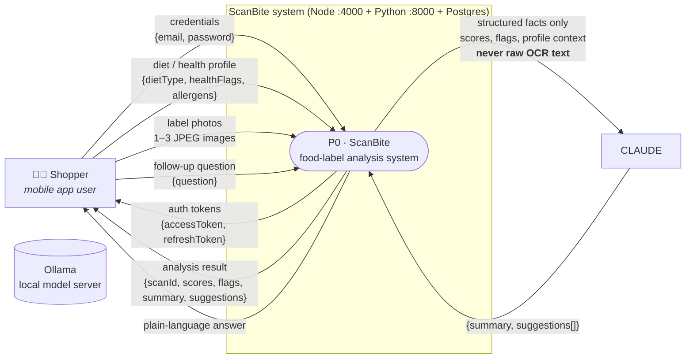
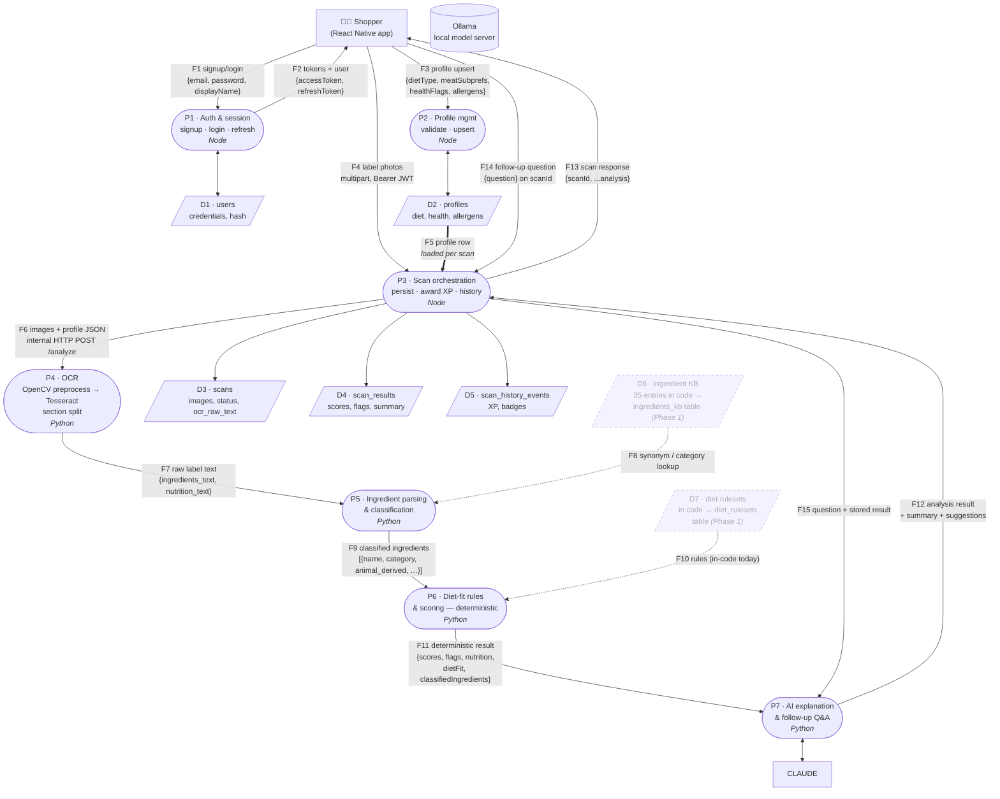
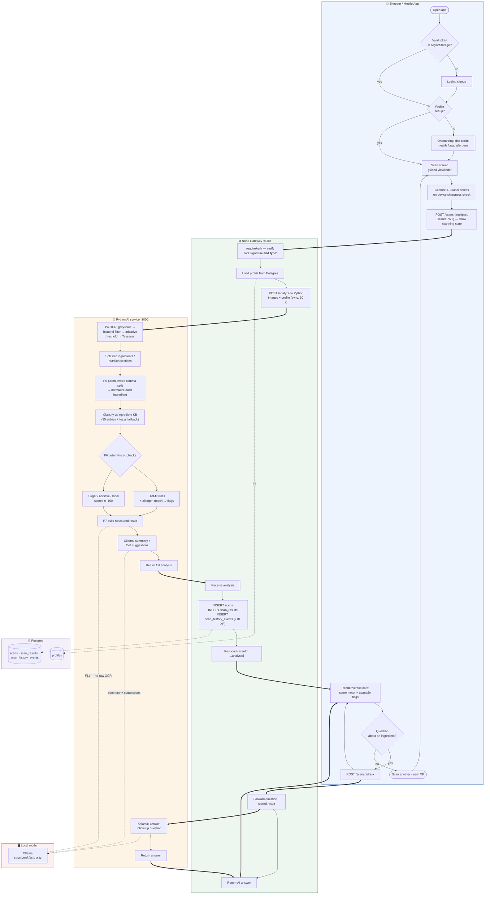

# ScanBite — DFD & Workflow

Companion to [`architecture-diagram.md`](architecture-diagram.md). This file
covers the two views that document is missing: a classical **Data Flow Diagram**
(context + Level 1) and the **end-to-end workflow** across all three services.

**Notation legend** (Mermaid has no native DFD symbols, so shapes are mapped):

| DFD element | Mermaid shape | Example |
|---|---|---|
| External entity | rectangle | `["Shopper"]` |
| Process | stadium `([...])` | `P1([...])` |
| Data store | parallelogram `[/ /]` | `D1[/"users"/]` |
| Data flow | labelled arrow | `-- "label photos" -->` |

Components that are planned but not yet implemented (Phase 3) are drawn with
dashed borders.

---

## 1. DFD — Level 0 (context diagram)

The whole system as one process, showing what crosses its boundary.

**Key boundary rule:** only structured, de-identified facts are sent to the
local Ollama model; raw OCR text and user identity never are (see
`ARCHITECTURE.md` §9).

---

## 2. DFD — Level 1

The system decomposed into its seven processes and seven data stores.
Read alongside the numbered flows.

### Flow table

| # | Data flow | From → To | Contents |
|---|---|---|---|
| F1 | Credentials | Shopper → P1 | email, password, displayName |
| F2 | Auth tokens | P1 → Shopper | accessToken (15 min), refreshToken (30 d) |
| F3 | Profile upsert | Shopper → P2 | dietType, meatSubprefs, healthFlags, allergens |
| F4 | Label photos | Shopper → P3 | 1–3 images, ≤ 8 MB each, Bearer JWT |
| F5 | Profile row | D2 → P3 | diet_type, health_flags, allergens (per scan) |
| F6 | Analyze request | P3 → P4 | images[] + profile JSON (multipart) |
| F7 | Raw label text | P4 → P5 | ingredients_text, nutrition_text |
| F8 | KB lookup | D6 → P5 | synonyms, category, animal_derived flags |
| F9 | Classified ingredients | P5 → P6 | name, category, e_number, root_allium |
| F10 | Diet rules | D7 → P6 | per-diet rules (hardcoded `if/elif` today) |
| F11 | Structured analysis | P6 → P7 | scores, flags, nutrition — **no prose** |
| F12 | Analysis + prose | P7 → P3 | F11 + summary + suggestions |
| F13 | Scan response | P3 → Shopper | scanId + full analysis |
| F14 | Follow-up question | Shopper → P3 | `{question}`, scanId |
| F15 | Q&A context | P3 → P7 | question + stored scan result |

**Trust boundary:** F11 is the deterministic/LLM seam. P7 receives only
already-computed facts (F11) — it never sees raw OCR text (F7) and never
recomputes a score or diet verdict.

---

## 3. Workflow — scan → verdict (swimlane)

The happy path end to end, including onboarding and the follow-up Q&A loop.

`==>` = synchronous HTTP call (blocking); `-.->` = data read/write or
out-of-band context flow.

\* **Bug note:** today `middleware/auth.js` verifies the signature but never
checks `payload.type`, so a refresh token authenticates protected routes —
drawn as *should be*, see README "Known issues" #1.

### Workflow summary

1. **Enter** — cold start → login (or restored session) → onboarding if no profile.
2. **Capture** — guided camera, 1–3 shots, on-device quality check.
3. **Orchestrate** — Node validates JWT, loads the profile row (F5), proxies
   images + profile to Python (F6).
4. **Analyze (Python, synchronous)** — OCR → parse → classify → deterministic
   diet rules & scores → local Ollama explanation → return.
5. **Persist** — Node writes `scans`, `scan_results`, `scan_history_events`
   (+10 XP), responds with `scanId` + analysis.
6. **Present** — verdict card with score meter and expandable flags.
7. **Loop** — ask follow-ups (F14/F15) or scan again.

### Error paths (not drawn)

- **Ollama is stopped or the model is missing** → P7 returns a clear service
  error; start Ollama and download the configured model (default: `llama3.2`).
- **Hosted provider selected (`LLM_PROVIDER=openai`)** → same clear errors for a
  missing/invalid `OPENAI_API_KEY`, an unreachable `OPENAI_BASE_URL`, or an
  unknown `OPENAI_MODEL`; each names the env var to fix.
- **OCR finds no "Ingredients:" / "Nutrition Facts" marker** → empty sections →
  scores default, low-confidence result.
- **Unknown ingredient** → `unclassified`, no rule fires (silent pass — known
  issue #3).
- **No profile row** → defaults to `vegetarian` silently (known issue #5).
